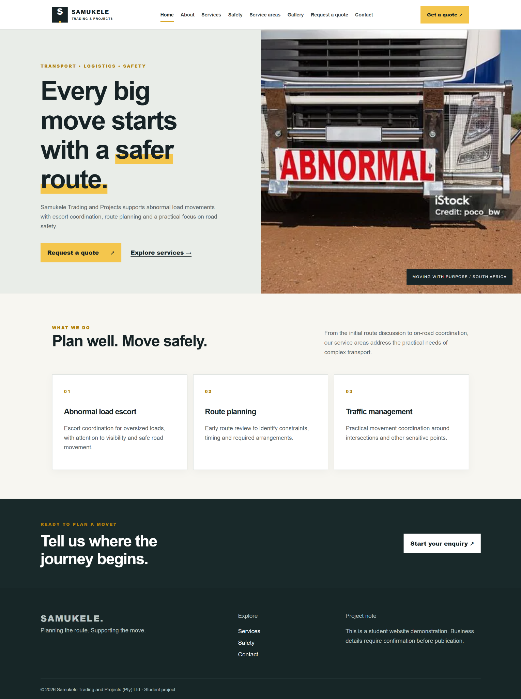
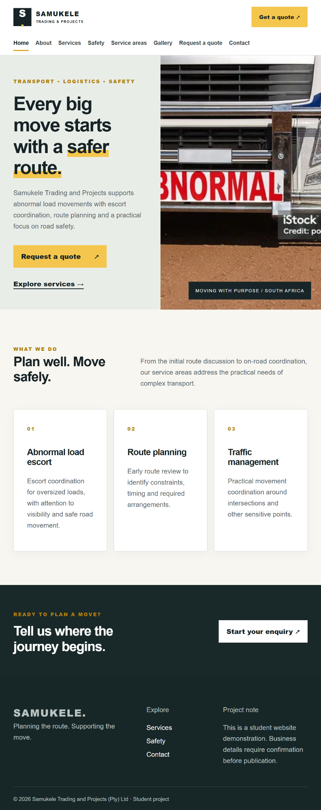
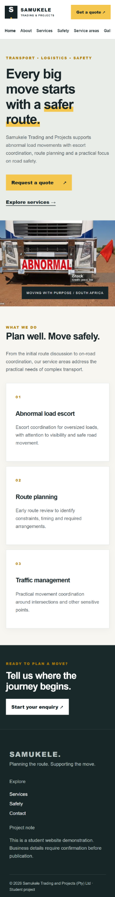

# Samukele Trading and Projects website

**Student ID:** ST10499221 (confirm student's full name before submission)  
**Project:** Part 1 repair and Part 2 responsive design, revised 25 September 2026.

## Overview and objectives
A student demonstration website for a proposed South African abnormal load escort and transport support business. It explains services, safety planning and route enquiries. The goal is to help prospective clients understand the offering and prepare a relevant enquiry. The project proposal in `docs/PROJECT-PROPOSAL.md` defines audience, scope, KPIs, estimated timeline and illustrative budget.

## Pages and features
`index.html` Home; `about.html` About; `services.html` Services; `compliance.html` Safety; `areas.html` Service Areas; `gallery.html` Gallery; `enquiry.html` Request a Quote; `contact.html` Contact. See `docs/SITEMAP.md` and `docs/WIREFRAMES.md`. Eight pages reflect the original chosen proposal. Shared semantic header, navigation, main and footer; accessible labels and focus styles; consistent calls to action.

The form uses `mailto:` to prepare an email through the visitor's configured mail application. It is a demonstration and does not guarantee delivery. Do not claim a live quote submission service. Verified contact details and a secure server endpoint are required before launch.

## Structure
- Root: eight HTML pages and README.
- `css/style.css`: shared desktop, tablet and mobile styles.
- `js/`: reserved for Part 3; Part 2 requires no JavaScript.
- `images/`: four original submitted assets plus 320-pixel JPEG variants and 320/600-pixel WebP variants.
- `docs/`: project proposal, sitemap and wireframes.
- `research/`: original proposals, competitor screenshot and source notes.
- `screenshots/`: full-page browser captures supplied by the student for desktop, tablet and mobile views.

## Part 1 repairs
The original ZIP had five pages, a misspelled `complience.html`, broken image references, no README and no separate enquiry page. This revision adds the proposed pages; fixes filenames and links; writes the proposal with schedule and budget; adds sitemap and wireframes; preserves research files; and adds comments to the shared page structure. The original contact and compliance claims have been qualified because company details were not independently supplied. The lecturer's feedback specifically called out wireframes, timeline, budget, file structure, GitHub evidence, references and code comments.

## Part 2 work
All eight pages link `css/style.css`. It includes a colour and typography system; Grid and Flexbox layouts; hover, focus and active states; relative units; breakpoints at 68rem and 45rem; and reduced-motion support. Every site image now has a `<picture>` element with 320w/600w WebP alternatives, a JPEG fallback with `srcset`, a `sizes` hint, intrinsic dimensions and descriptive alternative text. The variants were resized from the student's supplied 600-pixel images, so they do not invent higher-resolution detail.

## Browser and device testing
The student supplied full-page captures from Chrome responsive mode for desktop, tablet and mobile views. Visual review confirms that the homepage image, text, cards and footer display in the three layouts. At the narrow mobile view, the navigation scrolls horizontally as designed; swipe across it to reach links beyond the visible edge. These captures document the homepage layout, while testing of all pages, links, form behaviour and a second browser/device remains for the student to record honestly.

| View | Browser mode | Evidence |
|---|---|---|
| Desktop | Chrome responsive desktop view | [desktop.png](screenshots/desktop.png) |
| Tablet | Chrome responsive tablet view | [tablet.png](screenshots/tablet.png) |
| Mobile | Chrome responsive mobile view | [mobile.png](screenshots/mobile.png) |

### Captured layouts

**Desktop**  

**Tablet**  

**Mobile**  

To test locally, run `python3 -m http.server 8000` from this directory and visit `http://localhost:8000/`. Inspect all eight pages in Chrome and another browser or real device if available. Check navigation, horizontal overflow, images, focus states and the mailto demonstration. Record actual findings before submitting.

## Timeline and milestones
See the seven-step schedule and deliverables in `docs/PROJECT-PROPOSAL.md`.

## Changelog
### 25 September 2026 — Part 1 feedback corrections
- Preserved both original proposals and added a structured chosen-organisation proposal with objectives, KPIs, timeline and estimated budget.
- Added research provenance, sitemap and wireframes; documented the eight-page file structure.
- Replaced the misspelled compliance page path and broken image paths; introduced dedicated enquiry and contact pages.
- Added four planned pages from the chosen proposal, semantic shared page structure, clear HTML comments, and consistent navigation.
- Qualified unverified company claims and contact details instead of presenting placeholders as facts.
### 25 September 2026 — Part 2
- Added one external CSS stylesheet to all pages; established typography, spacing, colour, Grid/Flexbox and interactive states.
- Added tablet and mobile breakpoints, single-column small-screen layouts, flexible media and accessible focus styling.
- Added responsive image alternatives, `srcset`, `sizes`, and `<picture>`; embedded the student-supplied desktop, tablet and mobile homepage captures in this README. GitHub commit history remains to be produced in the student's own repository.

## References and source register
1. ST10499221. (2026). *Part 1 two proposals and chosen proposal*. Original student submission, preserved under `research/documents/`.
2. ST10499221. (2026). *Part 1 HTML and four image files*. Original student submission, adapted into this project. Image creator and licence unknown.
3. ST10499221. (2026). *Competitor research screenshot*. Original student submission, preserved under `research/images/`.
4. WeDES020w PoE assignment excerpts and lecturer Part 1 overall feedback supplied by the student (2026). Requirements and corrections documented in this README.

Confirm the institution's required citation style and image permissions before final submission.

## Submission handoff
Inspect the project, complete any remaining browser checks, and place it in the lecturer-created **private** GitHub repository. The repository URL and authentic commit history cannot be manufactured from a ZIP. Commit this revision with descriptive messages, push to the assigned remote, retain the three embedded browser captures, and submit that repository URL in the LMS. Also submit the proposal PDF and research ZIP where the LMS requests separate attachments. Do not imply earlier commits were made when they were not.
